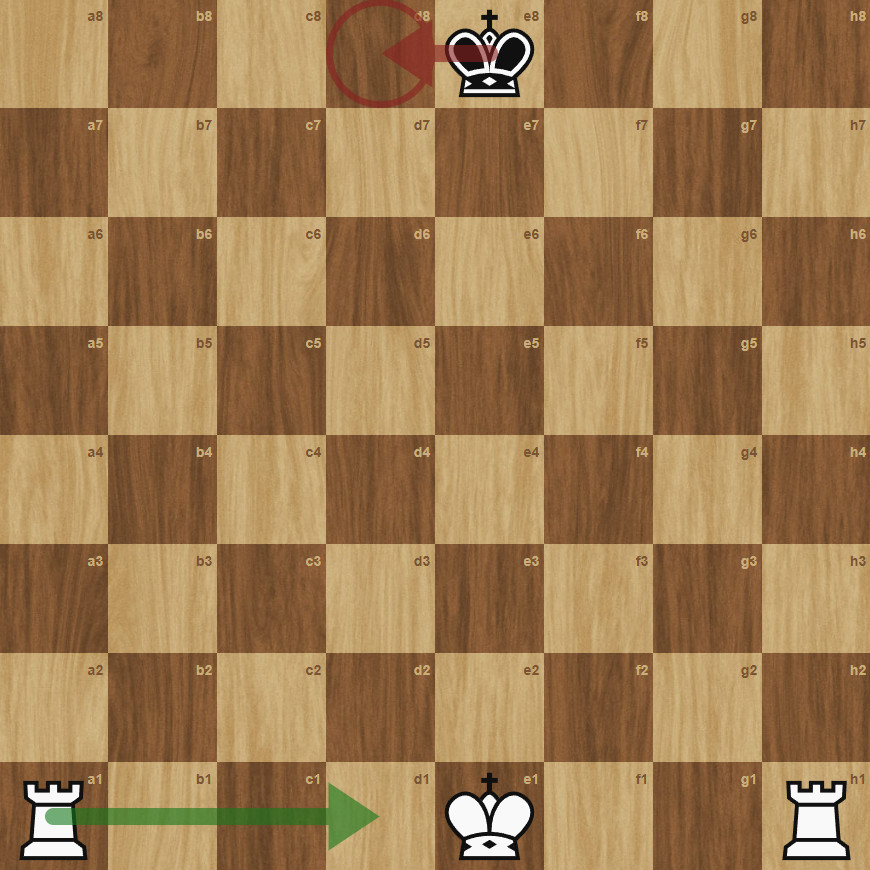

# perft-debugger

A command line tool for finding move generation bugs in UCI chess engines. \
`perft-debugger` runs perft tests with your engine, and searches for variations
your engine generates illegal moves in. \
[cozy-chess](https://github.com/analog-hors/cozy-chess/) is used
as a ground truth move generator for sorting out illegal moves.

## Usage

```
perft-debugger.exe [OPTIONS] <ENGINE_PATH> [POSITION_FEN]

Arguments:
  <ENGINE_PATH>   Executable path for the engine to be diagnosed
  [POSITION_FEN]  Position (in FEN) to diagnose [default: ...]

Options:
  -d, --depth <MAX_DEPTH>        Max perft depth to test [default: 4]
  -s, --searches <MAX_SEARCHES>  Maximum illegal moves to attempt a search for [default: 3]
```

### Example

The following output uses an engine that allows moving into check:

`cargo run --release -- ./path/to/engine "4k3/8/8/8/8/8/8/R3K2R w KQ - 0 1" --depth 2 --searches 1`

```
Perft 1 took 0.1 seconds. Nodes: 26
Perft 2 took 0.0 seconds. Nodes: 112

Perft failed at depth 2, finding failing leaf node(s)...
position fen 4k3/8/8/8/8/8/8/R3K2R w KQ - 0 1

Failing leaf node found!
Engine generated an illegal move: e8d8
moves a1d1

Max search limit hit. There might be more failing leaf nodes!
```

Example position (with moves highlighted):



## Requirements

Your engine must be UCI compatible to the following commands:

- `position fen [FEN POSITION] moves [MOVES]`
- `go perft [DEPTH]`
- `quit`

And the `go perft` command must produce stockfish style per-move outputs.

Example: 

```sh
position fen 4k3/8/8/8/8/8/8/R3K2R w KQ - 0 1 moves a1d1 e8f8
go perft 2

# (Any output before the list of moves is ignored)
...

d1a1: 5
d1b1: 5
...
e1f2: 5
e1g1: 4 # Castling moves are notated as king->king not king->rook!

Nodes searched: 106
```

perft-debugger will be looking for the following strings:

- `[move]: [node count]`
- `Nodes searched: [total node count]`

### Incompatible engines

If your engine is not compatible you can also use `perft-debugger` as a library,
to interface directly with your engine.

See [library_use_example.md](./library_use_example.md) for more.

## Building

You shouldn't have any problems building with cargo normally.

```sh
cargo build --release
```

But also check out cozy-chess's: [A note on CPU features and performance](https://docs.rs/cozy-chess/latest/cozy_chess/#a-note-on-cpu-features-and-performance).

## AI Use disclosure

LLMs were not used for a majority of this project with 2 exceptions:

1. Assisting in diagnosing some logic bugs
2. Helping write documentation

TODO: Explain AI assistance for C FFI 
